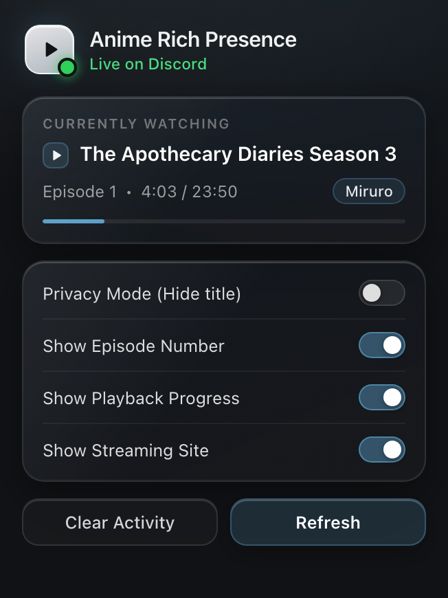
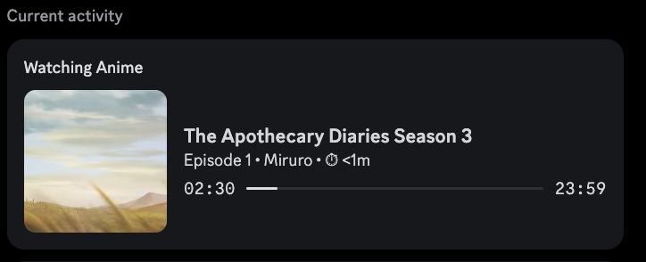
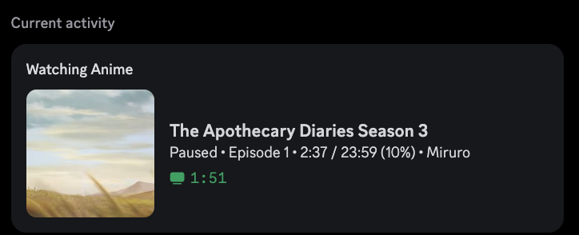

# 🎌 Anime Rich Presence for Discord

> **Note:** Just a fun project I worked on! Still a work in progress in places as streaming sites change, feel free to explore or tinker with it.

Show what anime you're watching in real-time on Discord with native **Watching** status, live episode progress bars, dynamic cover art, and a frosted-glass browser extension.

### Supported Sites
- **Re:Anime** (`reanime.cz`)
- **KotoPlay** (`kotoplay.to`)
- **Miruro** (`miruro.cx`, `miruro.to`, `miruro.tv`)
- **Gotaku** (`gotaku.to`)
- **AnimePahe** (`animepahe.pw` and mirrors — *availability depends on mirror/Cloudflare access*)

---

## 📸 Preview

| Browser Extension | Discord Activity *(Playing & Paused)* |
| :---: | :---: |
|  | <br><br> |

---

## ✨ Features

- **👀 Native Watching Status & Live Progress Bar**: Displays `Watching Anime` with Discord's native live progress bar while playing, a custom watch-session counter (`⏱ 14m`) in the status line, and a persistent session timer when paused.
- **💡 Dynamic Toolbar Icon**: Extension icon glows bright when connected to Discord, shifts to amber when waiting for Discord, and dims when the desktop app is offline—updated in real time over SSE (`/events`), no click needed.
- **🪟 Frosted Glass Extension UI**: Neutral translucent popup that samples a subtle accent tint from the anime you're watching, with toggles for:
  - **Privacy Mode**: Hides anime title, episode, cover art, and progress on Discord.
  - **Show Episode Number**, **Show Playback Progress**, and **Show Streaming Site**.
- **🖼️ AniList Cover Art + Caching**: Uses site artwork when available or fetches covers from AniList GraphQL with local caching.
- **⚡ Lightweight & Resilient**: Only injects into supported anime tabs (including cross-origin player iframes), persists state across MV3 service worker sleeps, and runs Discord RPC on a dedicated thread with a 3s reconnect heartbeat.

---

## 🚀 Quick Setup

### 1. Discord Application Setup *(Optional)*

The app works out of the box using the default client ID and `ActivityType.WATCHING` (`Watching Anime`). If you want to customize it with your own Discord app:

1. Go to the [Discord Developer Portal](https://discord.com/developers/applications) and click **New Application**.
2. Name your application (e.g., **Anime**).
3. Copy the **Application ID**, duplicate `.env.example` as `.env`, and set `DISCORD_CLIENT_ID=<your-id>`.


---

### 2. Run the Desktop Backend

Requires Python 3.8+:

```bash
# 1. Clone repository
git clone https://github.com/sujay-515/anime-rich-presence.git
cd anime-rich-presence

# 2. (Optional) Configure environment variables
cp .env.example .env

# 3. Create virtual environment & install dependencies
python3 -m venv venv
source venv/bin/activate
pip install -r requirements.txt

# 4. Start the application
./run.sh
```

*(You can also run `./start_with_retry.sh` to auto-restart if the process stops, or pass `--verbose` to log every tick.)*

#### Optional `.env` Settings

| Variable | Default | Description |
| :--- | :--- | :--- |
| `DISCORD_CLIENT_ID` | Built-in ID | Custom Discord Application ID |
| `DISCORD_ACTIVITY_TYPE` | `watching` | `watching`, `playing`, `listening`, or `competing` |
| `DISCORD_ACTIVITY_NAME` | `Anime` | Label shown after `Watching ` |
| `DISCORD_STATUS_DISPLAY` | `details` | `details` (anime title), `state`, or `name` |
| `DISCORD_PROGRESS_BAR` | `true` | Native progress bar while playing (`false` uses green `📺` timer) |
| `DISCORD_SESSION_TIMER` | `true` | Shows `⏱ Xm` watch duration alongside the progress bar |
| `HOST` / `PORT` | `localhost` / `3000` | Local Flask bridge address |

---

### 3. Install the Browser Extension

1. Open your Chromium browser (Chrome, Brave, Edge, Opera).
2. Navigate to `chrome://extensions/`.
3. Enable **Developer mode** (top-right toggle).
4. Click **Load unpacked** and select the [`browser-extension`](./browser-extension) folder from this repository.
5. Pin the extension to your toolbar to see the live glowing/dimmed connection icon.

---

### 4. Start Watching!

1. Make sure the Discord desktop app is running.
2. Open any anime on **Re:Anime**, **KotoPlay**, **Miruro**, **Gotaku**, or **AnimePahe**.
3. Play an episode—your Discord status and extension popup will sync automatically.

---

## 🛠️ Architecture

```
┌──────────────────────────────────────┐
│          Browser Extension           │
│  (On-demand top & iframe detection)  │
└──────────────────┬───────────────────┘
                   │ POST /update (JSON)
                   ▼
┌──────────────────────────────────────┐
│         Python Backend App           │
│     (Flask Bridge on Port 3000)      │
└──────────────────┬───────────────────┘
                   │ Single-Thread RPC Worker
                   ▼
┌──────────────────────────────────────┐
│         Discord Desktop App          │
│       (Native Watching Status)       │
└──────────────────────────────────────┘
```

---

## 📄 License

[MIT License](./LICENSE). Feel free to use, modify, and distribute.
