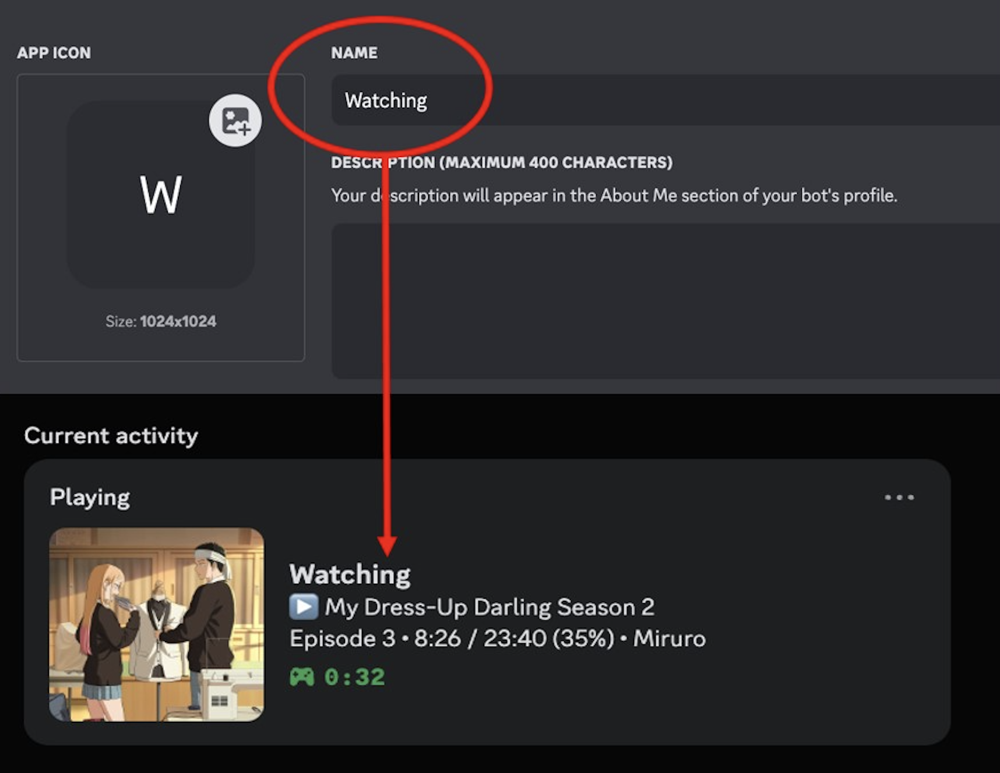

# 🎌 Anime Rich Presence for Discord

> **Note:** Just a fun project I worked on! Still a work in progress in places as streaming sites change, feel free to explore or tinker with it.

Show what anime you're watching in real-time on Discord with rich embeds, dynamic thumbnails, episode info, and interactive playback timers.

Supported sites:
- **Miruro** (`miruro.cx`, `miruro.to`, `miruro.tv`)
- **AnimePahe** (`animepahe.ru`, `animepahe.si`, `animepahe.org`, `animepahe.com`, `animepahe.pw`) via Kwik Player

---

## ✨ Features

- **📺 Real-time Detection**: Automatically detects anime title, episode number, playback progress, and pause/play state.
- **🖼️ AniList Dynamic Cover Art**: Automatically fetches high-resolution anime thumbnails from the AniList GraphQL API with local caching.
- **⏱️ Live Elapsed Timestamps**: Discord displays an accurate green playback timer synchronized with your video.
- **🎨 Modern Extension UI**: Sleek dark popup with live connection status and customizable display toggles:
  - **Privacy Mode**: Hides specific anime titles and episode numbers (shows "Watching Anime").
  - **Show Episode**: Toggle episode numbers on/off.
  - **Show Progress**: Toggle time progress display (`02:30 / 24:00`).
  - **Show Site Badge**: Toggle Miruro / AnimePahe badge.
- **🔄 Auto Reconnection**: Recovers smoothly when Discord opens, closes, or restarts.

---

## 🚀 Quick Setup

### 1. Discord Application Setup

1. Go to the [Discord Developer Portal](https://discord.com/developers/applications).
2. Click **New Application**.
3. Name it what you want Discord to display as your activity (for example, naming it **"Watching"** will make your Discord status display as **"Playing Watching"** or **"Watching <Anime Name>"**).
4. *(Optional)* Copy your **Application ID**, duplicate `.env.example` as `.env`, and set `DISCORD_CLIENT_ID=<your-id>` if you prefer your own custom client.



---

### 2. Run the Desktop Backend

Make sure you have Python 3.8+ installed:

```bash
# 1. Clone repository
git clone https://github.com/sujay-515/anime-rich-presence.git
cd anime-rich-presence

# 2. (Optional) Configure environment variables
cp .env.example .env

# 3. Create virtual environment & install dependencies
python3 -m venv venv
source venv/bin/activate
pip install -r requirements.txt

# 4. Start the application
./run.sh
```

*(You can also run `./start_with_retry.sh` if you want a background restart daemon).*

---

### 3. Install the Browser Extension

1. Open your Chromium browser (Chrome, Brave, Edge, Opera).
2. Navigate to `chrome://extensions/`.
3. Enable **Developer mode** (top right toggle).
4. Click **Load unpacked** and select the [`browser-extension`](./browser-extension) folder from this repository.
5. Pin the extension to your toolbar.

---

### 4. Start Watching!

1. Make sure Discord desktop app is running.
2. Open any anime on [Miruro](https://miruro.cx) or [AnimePahe](https://animepahe.ru).
3. Play any episode. The extension will automatically sync your playback status to Discord!

---

## 🛠️ Architecture

```
┌────────────────────────────────┐
│      Browser Extension         │
│  (Miruro / AnimePahe Detector) │
└───────────────┬────────────────┘
                │ POST /update (JSON)
                ▼
┌────────────────────────────────┐
│      Python Backend App        │
│    (Flask API on Port 3000)    │
└───────────────┬────────────────┘
                │ Discord IPC Socket (pypresence)
                ▼
┌────────────────────────────────┐
│      Discord Desktop App       │
│    (Custom Rich Presence)      │
└────────────────────────────────┘
```

---

## 📄 License

MIT License. Feel free to use, modify, and distribute.
